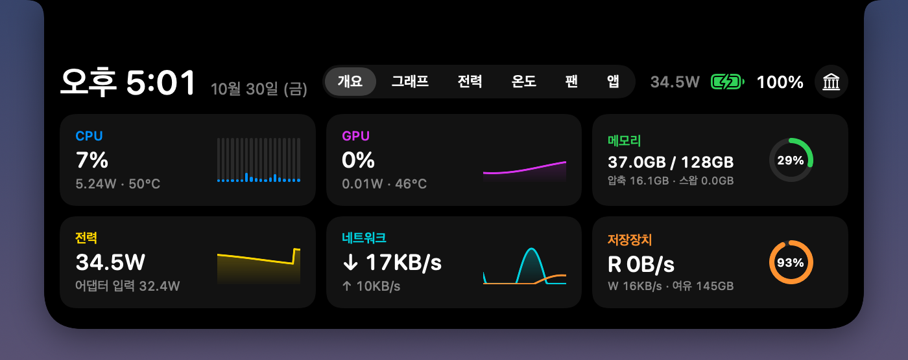
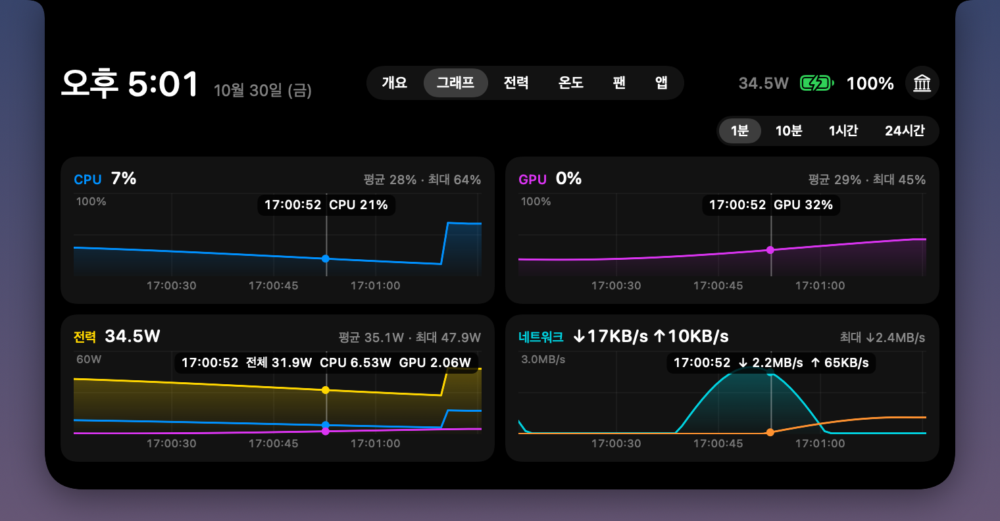
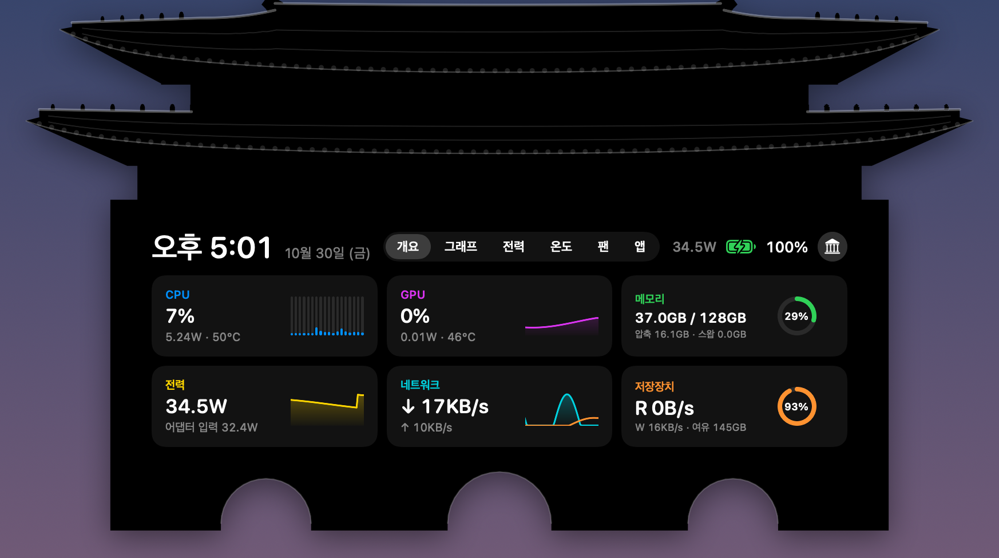
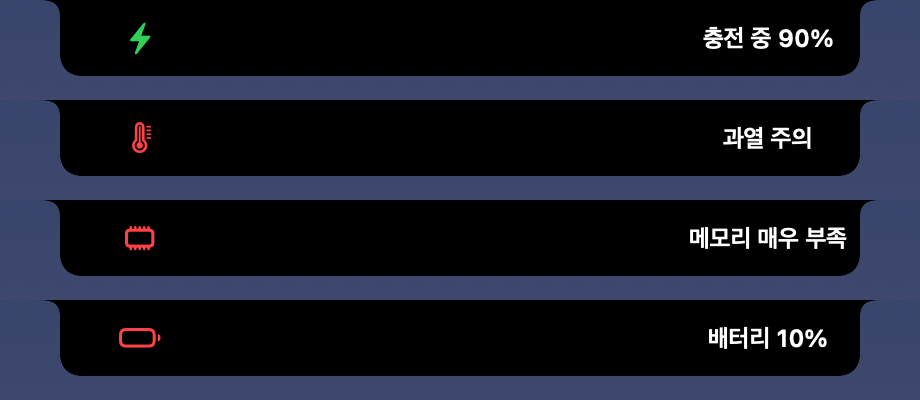
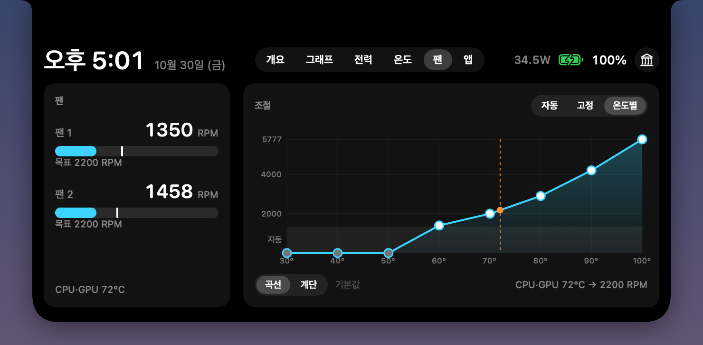

# Cheoma (처마)

[English](README.md) · 한국어

<p align="center">
  
</p>

**처마**는 한옥 지붕 끝에 길게 나온 부분이다. 비와 햇빛을 가려 주고, 그 밑에는 곶감이나 메주처럼 자주 쓰는 것을 걸어 둔다. 처마 끝 풍경은 바람이 불면 소리로 알려 준다.

Cheoma는 맥의 노치에서 같은 일을 한다.

- **어수선한 것을 가려 준다.** 노치 뒤로 숨은 메뉴바 아이콘을 노치 아래 패널로 꺼내 바로 누를 수 있다.
- **풍경처럼 알려 준다.** 충전기 연결, 잠금 해제, 과열, 메모리 부족, 배터리 부족을 노치 양옆에 작은 알림으로 띄운다.
- **맥 속 날씨를 보여 준다.** 노치에 마우스를 올리면 CPU·GPU·메모리·전력·네트워크·저장장치·온도와 많이 쓰는 앱이 한눈에 보인다.
- **시원하게 지켜 준다.** 팬 속도를 직접 정한다. 팬마다 고정 RPM을 주거나 온도별 커브를 그린다.

**[Cheoma 내려받기](https://github.com/m-kim77/cheoma/releases/latest/download/Cheoma.zip)** · 무료 · 오픈 소스 · Apple Silicon · macOS 14 이상

> **베타**: 아직 맥 한 대(MacBook Pro M5 Max, macOS 26)에서만 확인했다. 내 맥에서 안 되는 것이 있으면 [이슈](https://github.com/m-kim77/cheoma/issues)로 알려 주세요.

## 설치

1. [`Cheoma.zip`](https://github.com/m-kim77/cheoma/releases/latest/download/Cheoma.zip)을 내려받아 더블클릭으로 풀고, `Cheoma.app`을 응용 프로그램 폴더로 끌어 옮긴다.
2. Cheoma를 연다. 처음 열 때는 macOS가 막는다. Apple 공증을 받지 않은 앱이라서 그렇다 (공증은 유료 개발자 계정이 있어야 받을 수 있다). 소스가 이 저장소에 모두 있으니 직접 빌드해도 된다.
   - **macOS 15 이상**: 경고 창에서 **완료**를 누른다. 시스템 설정 › 개인정보 보호 및 보안에서 아래쪽 보안 항목까지 내려가 "Cheoma"이(가) 차단되었다는 문구 옆의 **그래도 열기**를 누른다. 이어서 뜨는 창에서 **그래도 열기**를 한 번 더 누르고 암호나 Touch ID로 확인한다.
   - **macOS 14**: `Cheoma.app`을 Control-클릭(우클릭) › **열기** › **열기**.
   - 터미널에서는 `xattr -dr com.apple.quarantine /Applications/Cheoma.app`로도 된다.
3. Cheoma는 Dock 아이콘 없이 메뉴바에서 돈다. 메뉴바에 `⌄`와 얇은 `|` 구분선이 생긴다. 노치에 마우스를 올리면 대시보드가 펼쳐진다.

필요한 기능을 켠다.

- **가려진 아이콘**: `⌄` › **권한 허용하러 가기** › 손쉬운 사용에서 Cheoma를 켠다.
- **팬 조절**: 대시보드 › **팬** 탭 › **도우미 설치**를 누르고 관리자 암호를 넣는다.
- **로그인 시 자동 실행**: `⌄` 우클릭 › **로그인 시 자동 실행**.

## 쓰는 법

### 노치 대시보드

노치에 마우스를 올리면 펼쳐지고, 마우스가 벗어나면 닫힌다.

<p align="center">
  
</p>

| 탭 | 보이는 것 |
|---|---|
| 개요 | CPU(코어별) · GPU · 메모리 · 전력 · 네트워크 · 저장장치 |
| 그래프 | CPU · GPU · 전력 · 네트워크를 1분 / 10분 / 1시간 / 24시간으로. 마우스를 올리면 그 시각의 값이 보인다. 기록은 앱을 다시 켜도 남는다 |
| 전력 | 시스템 전체 · CPU · GPU · 뉴럴 엔진 · 메모리 · 디스플레이 · 기타, 배터리 상태 |
| 온도 | CPU · GPU · SSD · 배터리 온도와 팬 RPM, CPU·GPU 온도 10분 그래프 |
| 팬 | 팬 조절 (아래). 팬이 없는 맥에서는 나오지 않는다 |
| 앱 | CPU · CPU 전력 · 메모리를 많이 쓰는 앱. 도우미 프로세스는 앱 하나로 합친다 |

오른쪽 위 기둥 모양 버튼으로 모양을 **기본**(둥근 네모)과 **광화문**(2층 지붕 아래 석축에 대시보드가 들어가는 검은 실루엣) 사이에서 바꾼다.

<p align="center">
  
</p>

### 가려진 메뉴바 아이콘

메뉴바에 자리가 모자라면 macOS는 넘치는 아이콘을 노치 뒤로 숨기고, 숨은 아이콘은 누를 방법이 없다. `⌄`를 누르면 이 아이콘들이 메뉴바 아래 패널에 펼쳐지고, 눌러서 바로 쓸 수 있다. 따로 설정할 것은 없다.

- **일부러 숨기기**: 패널에서 **정리**를 누르고, 메뉴바에서 ⌘를 누른 채 아이콘을 `|` 왼쪽으로 끈 다음 **완료**를 누른다. 다시 꺼낼 때는 `|` 오른쪽으로 끌어 놓는다.
- **패널에서 아이콘을 우클릭**하면 열기 · Finder에서 보기 · 앱 종료 메뉴가 나온다. 앱 자체의 우클릭 메뉴는 띄울 수 없다. macOS가 손쉬운 사용으로는 아이콘 누르기(왼쪽 클릭)만 허락하기 때문이다.
- 아이콘은 손쉬운 사용 API로 누른다. 마우스를 움직이거나 아이콘 순서를 대신 바꾸지 않는다.
- macOS 26은 메뉴바가 넘칠 때(새 아이콘이 생기는 등) 아이콘 순서를 스스로 섞기도 한다.

### 알림

<p align="center">
  
</p>

노치 양옆에 작은 알림이 3초쯤 떴다 사라진다. 소리는 없다.

- 충전기 연결·해제, 잠금 해제
- 경고: 과열, 메모리 부족, 배터리 20%·10%. 같은 종류는 10분에 한 번만 띄우고, 더 심해지면 바로 띄운다. `⌄` 우클릭 › **경고 알림**으로 끈다.
- 터미널에서 보낸 알림 ([터미널에서 알림 보내기](#터미널에서-알림-보내기))

### 팬 조절

<p align="center">
  
</p>

**팬** 탭에서 모드를 고른다. 고른 모드와 값은 기억했다가 앱을 다시 켜면 이어서 적용한다. 왼쪽에는 팬마다 지금 RPM과 목표(흰 눈금)가 보인다.

- **자동**: macOS가 조절한다 (기본). 시원할 때는 팬이 멈춰 있다.
- **고정**: 슬라이더로 RPM을 정한다. 끄는 동안에도 0.2초마다 적용돼서 팬이 바로 따라온다.
  - **좌우 같이**를 끄면 팬마다 따로 정한다.
  - **지금 속도 저장**으로 자주 쓰는 속도를 4개까지 저장해 두고 눌러서 바로 쓴다.
  - **멈춤**은 팬을 세운다. 맥이 받아들이지 않으면 자동으로 되돌린다.
- **온도별**: 30·40·…·100°C 여덟 점의 RPM을 그래프에서 위아래로 끌어서 정한다.
  - **곡선**은 점 사이를 이어서 자연스럽게 바뀌고, **계단**은 다음 점의 온도에 닿을 때까지 그대로 있다가 한 번에 바뀐다.
  - 커브는 뜨거운 쪽으로 갈수록 내려가지 않는다. 점을 올리면 더 뜨거운 쪽 점들이 같이 올라가고, 내리면 더 시원한 쪽 점들이 같이 내려간다.
  - 아래 회색 띠(팬 최소보다 낮은 곳)에 둔 구간은 macOS 자동이다. **기본값**은 처음 커브로 되돌린다.
  - 기준 온도는 CPU·GPU 평균 중 높은 값이다. 식을 때는 3°C 더 내려가야 속도를 낮춘다 (경계에서 팬이 오르내리지 않게).

안전장치:

- 수동 설정은 앱이 켜져 있는 동안만 유지된다. 앱을 끄거나, 앱이 비정상 종료되거나, 20초 동안 응답이 없으면 자동으로 돌아간다. 잠자는 시간은 세지 않는다.
- CPU가 95°C를 넘으면 (팬을 멈춘 동안은 85°C) 자동으로 돌아간다. 앱에도 자동으로 표시되고 이유를 알려 준다.
- 자동으로 되돌리기에 실패하면 도우미가 2초마다 다시 시도한다.
- 팬이 8초 안에 설정한 속도를 따라오지 않으면 자동으로 되돌리고 알려 준다.
- 도우미는 각 팬의 최소~최대 범위 안에서 속도를 정하거나 자동으로 되돌리는 일만 할 수 있다.
- 도우미는 설치할 때의 Cheoma와 코드 서명이 같은 앱하고만 통신한다.

### 우클릭 메뉴

메뉴바의 `⌄`를 우클릭하면 나온다.

| 메뉴 | 하는 일 |
|---|---|
| 가려진 아이콘 보기 | `⌄`를 왼쪽 클릭한 것과 같다 |
| \| 왼쪽 아이콘 숨기기 | `\|` 왼쪽에 둔 아이콘을 숨기거나 다시 보이게 한다 |
| 노치 알림 테스트 | 알림이 어떻게 뜨는지 본다 |
| 경고 알림 (과열·메모리·배터리) | 경고 알림을 켜고 끈다 |
| 로그인 시 자동 실행 | 로그인하면 Cheoma를 띄운다 (기본은 꺼짐) |
| 노치 모양 › 기본 / 광화문 | 대시보드 모양을 바꾼다 |
| 종료 | Cheoma를 끈다 |

### 터미널에서 알림 보내기

```sh
/Applications/Cheoma.app/Contents/MacOS/Cheoma --notify "빌드 완료" --symbol hammer.fill --color green
```

`--symbol`은 SF Symbol 이름, `--color`는 green · red · orange · yellow · blue · purple · pink · cyan · teal · white · gray 중 하나다. 내용은 40자까지 보인다.

오래 걸리는 작업이 끝날 때 띄우려면 명령 뒤에 붙인다.

```sh
make && /Applications/Cheoma.app/Contents/MacOS/Cheoma --notify "빌드 성공" --symbol checkmark.circle.fill --color green \
     || /Applications/Cheoma.app/Contents/MacOS/Cheoma --notify "빌드 실패" --symbol xmark.circle.fill --color red
```

## 권한

| 권한 | 왜 필요한가 | 어디서 |
|---|---|---|
| 손쉬운 사용 | 노치 뒤에 가려진 메뉴바 아이콘을 읽고 누르려고 | `⌄` › 권한 허용하러 가기, 또는 시스템 설정 › 개인정보 보호 및 보안 › 손쉬운 사용 |
| 관리자 암호 (한 번) | 팬 속도를 바꾸는 작은 도우미(root로 도는 백그라운드 서비스)를 설치하려고 | 팬 탭 › 도우미 설치 |

대시보드, 센서, 알림은 권한 없이 동작한다.

## 개인정보

Cheoma에는 네트워크 코드가 없다. 사용 통계도, 업데이트 확인도, 계정도 없다. 측정한 값은 모두 내 맥 안에만 남는다.

## 업데이트

Cheoma는 아직 스스로 업데이트하지 않는다. 새 버전 소식을 받으려면 이 페이지 위쪽의 **Watch** › **Custom** › **Releases**를 켜 둔다.

1. Cheoma를 끈다: `⌄` 우클릭 › **종료**.
2. 새 [`Cheoma.zip`](https://github.com/m-kim77/cheoma/releases/latest/download/Cheoma.zip)을 받아 응용 프로그램 폴더의 `Cheoma.app`을 바꾼다. macOS가 **그래도 열기**를 다시 물을 수 있다.
3. 가려진 아이콘이 안 눌리면 손쉬운 사용 권한이 예전 버전에 묶여 있는 것이다. 시스템 설정 › 개인정보 보호 및 보안 › 손쉬운 사용에서 Cheoma를 골라 `−`로 지우고 다시 허용한다. 터미널에서는 `tccutil reset Accessibility io.github.m-kim77.cheoma`로 지운다.
4. 팬 조절을 쓴다면 업데이트한 뒤 팬 탭에 **다시 설치**가 뜬다. 도우미는 설치할 때의 그 빌드하고만 통신하기 때문이다. 누르고 암호를 넣는다.

설정과 그래프 기록은 그대로 남는다.

## 지우기

1. 팬 도우미를 설치했다면: 팬 탭에서 **자동**을 고르고 오른쪽 아래 **도우미 제거**를 누른다.
2. `⌄` 우클릭 › **로그인 시 자동 실행**이 켜져 있으면 끄고, **종료**를 누른다.
3. `Cheoma.app`을 휴지통으로 옮긴다.
4. 설정, 그래프 기록, 로그, 권한 항목까지 지우려면:

   ```sh
   defaults delete io.github.m-kim77.cheoma
   rm -rf ~/Library/Application\ Support/Cheoma ~/Library/Logs/Cheoma.log
   tccutil reset Accessibility io.github.m-kim77.cheoma
   ```

도우미를 지우기 전에 앱부터 지웠다면:

```sh
sudo launchctl bootout system/io.github.m-kim77.cheoma.fanhelper
sudo rm /Library/LaunchDaemons/io.github.m-kim77.cheoma.fanhelper.plist /Library/PrivilegedHelperTools/io.github.m-kim77.cheoma.fanhelper
```

## 문제가 생기면

- **"손상되었기 때문에 열 수 없습니다"**: 공증받지 않은 앱을 내려받으면 macOS가 이렇게 말하기도 한다. `xattr -dr com.apple.quarantine /Applications/Cheoma.app`을 실행하고 다시 연다.
- **메뉴바에 `⌄`가 안 보인다**: 메뉴바가 꽉 차면 Cheoma 아이콘도 노치 뒤로 숨을 수 있다. 메뉴바 앱을 한두 개 끄고, ⌘를 누른 채 `⌄`를 시계 쪽(오른쪽)으로 끌어 둔다. 옮긴 자리는 macOS가 기억한다.
- **가려진 아이콘이 안 눌린다**: [업데이트](#업데이트)의 3번을 본다.
- **대시보드가 안 열린다**: 노치 바로 위에 마우스를 올린다. 노치가 없는 맥에서는 화면 위 가운데에 작은 검은 노치를 그린다.
- **값이 "—"로 나온다**: 구성요소별 전력(IOReport)과 전력·온도·팬 센서(SMC)는 Apple이 공개하지 않은 인터페이스라, macOS 업데이트로 막히면 그 값만 비어 보인다.
- **로그**: `~/Library/Logs/Cheoma.log`, 팬 도우미는 `/var/log/io.github.m-kim77.cheoma.fanhelper.log`.

그래도 안 되면 [이슈](https://github.com/m-kim77/cheoma/issues)로 알려 주세요.

## 알아둘 것

- 팬 조절은 MacBook Pro(M5 Max)에서 확인했다. M1·M2는 수동 제어 방식이 다를 수 있는데, 팬이 따라오지 않으면 8초 안에 자동으로 되돌린다. MacBook Air는 팬이 없어서 팬 탭이 나오지 않는다.
- 다른 앱·게임의 FPS는 공개 API로 읽을 수 없어 화면 최대 주사율만 보여 준다.
- 앱 탭은 내 계정 프로세스만 보여 준다. WindowServer, kernel_task 같은 시스템 프로세스는 읽을 권한이 없다. "CPU 전력"은 CPU 몫만 추정한 값이라 GPU를 많이 쓰는 앱은 실제보다 작게 나온다.
- CPU 사용량은 대시보드가 닫혀 있으면 약 0.2%, 열려 있으면 약 1%다. 닫혀 있으면 2초마다(온도·구성요소별 전력은 4초), 열려 있으면 1초마다(온도·구성요소별 전력은 2초) 잰다.

## 직접 빌드하기

Apple Silicon 맥과 Xcode 또는 Xcode Command Line Tools(Swift 5.9 이상)가 있어야 한다.

```sh
git clone https://github.com/m-kim77/cheoma.git
cd cheoma
scripts/build-app.sh --install   # 릴리스 빌드 → ~/Applications/Cheoma.app 설치
open ~/Applications/Cheoma.app
```

- 키체인에 있는 Developer ID Application이나 Apple Development 인증서로 서명한다. 그래서 다시 빌드해도 손쉬운 사용 권한이 유지된다. 둘 다 없으면 ad-hoc으로 서명하고, 빌드할 때마다 권한을 다시 줘야 한다. 인증서를 고르려면 `SIGN_IDENTITY`, ad-hoc으로 서명하려면 `SIGN_IDENTITY=-`를 준다.
- 팬이 덜 돌도록 기본으로 동시 작업 2개(`JOBS=2`)만 쓴다.
- 배포판과 같은 조건이 되도록 hardened runtime으로 서명한다. `SIGN_IDENTITY`(Developer ID 인증서)와 `NOTARY_PROFILE`(공증 프로필)을 주면 배포용으로 서명·공증한다 ([배포 계획](docs/DISTRIBUTION.md)).
- 개발 중에는 `swift build && .build/debug/Cheoma`로 바로 실행해도 된다. 이때는 로그인 시 자동 실행을 쓸 수 없다.
- 단위 테스트는 `scripts/test.sh`. XCTest는 Xcode에 들어 있어서, 명령줄 도구만 선택돼 있으면 Xcode의 툴체인으로 돌린다.

개발용 옵션:

| 옵션 | 내용 |
|---|---|
| `--stats` | UI 없이 3초간 센서 값 출력 |
| `--menubar-items` | 메뉴바 아이콘 목록과 가려짐 여부 출력 |
| `--render <폴더>` | 노치 UI를 PNG로 저장하고, 탭마다 내용이 펼친 크기 안에 들어가는지 재서 알려준다 (디버그 빌드, 화면 기록 권한 불필요) |
| `--bench [초] [탭]` | 센서 한 번 읽는 시간과 상황·탭별 CPU 사용률·그래프 그리기·창 배치 횟수 측정 (대시보드는 1% 불투명도로 띄움, 팬과 기록 파일은 안 건드림) |
| `--notify "내용" [--symbol 이름] [--color green]` | 실행 중인 앱에 알림 띄우기 |

데이터 위치:

- 설정: `defaults read io.github.m-kim77.cheoma`
- 그래프 기록: `~/Library/Application Support/Cheoma/history.plist`
- 오류 로그: `~/Library/Logs/Cheoma.log`
- 팬 도우미: `/Library/PrivilegedHelperTools/io.github.m-kim77.cheoma.fanhelper`, `/Library/LaunchDaemons/io.github.m-kim77.cheoma.fanhelper.plist`. 설치할 때의 앱과 코드 서명(지정 요구사항)이 같은 앱에서 온 연결만, 메시지마다 확인하고 받는다. ad-hoc 서명 릴리스는 업데이트할 때마다, 인증서로 서명한 빌드는 인증서가 바뀔 때 팬 탭에 "다시 설치"가 뜬다. 설치할 때는 관리자 셸이 도우미를 root 폴더로 복사한 뒤 서명을 확인하고 설치한다.

구조:

```
Sources/
├── Cheoma/              앱
│   ├── Notch/           노치 창, 모양, 대시보드(개요·그래프·전력·온도·팬·앱)
│   ├── MenuBar/         메뉴바 아이콘(⌄, |), 가려진 아이콘 패널
│   ├── Stats/           센서 측정(CPU·GPU·메모리·네트워크·디스크·전력·온도·앱별 사용량), 기록
│   ├── Fans/            팬 도우미 연결·설치
│   ├── Events/          충전기·잠금 해제 감지, 경고 알림(과열·메모리·배터리)
│   └── Debug/           --render 미리보기, --bench
├── CheomaShared/        SMC 접근, 팬 도우미 XPC 규약 (앱과 도우미가 같이 씀)
└── CheomaFanHelper/     관리자 권한 팬 도우미
```

진행 상황과 남은 일은 [docs/PROGRESS.md](docs/PROGRESS.md), 기술 메모는 [docs/NOTES.md](docs/NOTES.md), 배포 계획은 [docs/DISTRIBUTION.md](docs/DISTRIBUTION.md)에 있다.

## 라이선스

[GPL-3.0](LICENSE). 고쳐서 다시 배포할 때는 고친 소스도 같은 라이선스로 공개해야 한다. "Cheoma"라는 이름과 아이콘은 이 프로젝트를 가리키는 데만 쓴다.
