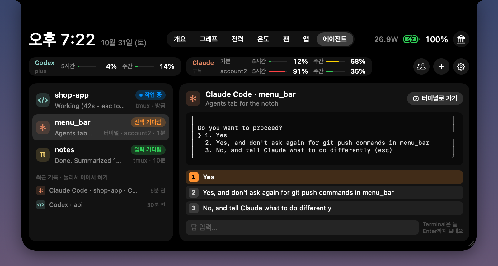

# Cheoma (처마)

English · [한국어](README.ko.md)

<p align="center">
  
</p>

A **cheoma** is the long, curved eave of a traditional Korean house. It shades the rooms from sun and rain. People hang everyday things under it, like dried persimmons, and a wind chime at its tip rings when the wind blows.

Cheoma does the same for your MacBook's notch:

- **Shelters the clutter.** Menu bar icons hidden behind the notch drop down in a panel right under it, ready to click.
- **Rings the chime.** Charger, unlock, overheating, low memory and low battery show up as small alerts around the notch.
- **Watches the weather inside your Mac.** Hover over the notch to see CPU, GPU, memory, power, network, storage, temperatures and the apps using the most.
- **Keeps things cool.** Set fan speeds yourself: a fixed RPM per fan, or a temperature curve.
- **Calls you back to the agents.** See which Claude Code, Codex, OpenCode or pi session is waiting for you, answer it from the notch, and keep an eye on your subscription limits.

**[Download Cheoma](https://github.com/m-kim77/cheoma/releases/latest/download/Cheoma.zip)** · free and open source · Apple Silicon · macOS 14 or later · the interface is in Korean (this page translates every label)

> **Beta.** So far Cheoma has been tested on one Mac: a MacBook Pro (M5 Max) on macOS 26. If something doesn't work on yours, please [open an issue](https://github.com/m-kim77/cheoma/issues).

## Install

1. Download [`Cheoma.zip`](https://github.com/m-kim77/cheoma/releases/latest/download/Cheoma.zip), double-click it to unzip, and drag `Cheoma.app` into your Applications folder.
2. Open Cheoma. The first time, macOS blocks it because the app is not notarized by Apple. Notarization needs a paid developer account; the full source is in this repository if you'd rather build it yourself.
   - **macOS 15 or later**: click **Done** in the warning. Open System Settings › Privacy & Security, scroll down to Security, and click **Open Anyway** next to "Cheoma was blocked". Click **Open Anyway** again in the dialog that follows, and confirm with your password or Touch ID.
   - **macOS 14**: Control-click `Cheoma.app`, choose **Open**, then click **Open** again.
   - Or, in Terminal: `xattr -dr com.apple.quarantine /Applications/Cheoma.app`
3. Cheoma lives in the menu bar and has no Dock icon. Two items appear there: `⌄` and a thin `|` divider. Hover over the notch to open the dashboard.

Then turn on what you need:

- **Hidden icons**: click `⌄` › **권한 허용하러 가기** (Allow access) and switch on Cheoma under Accessibility.
- **Fan control**: open the dashboard › **팬** (Fans) tab › **도우미 설치** (Install helper), and enter an administrator password.
- **Start at login**: right-click `⌄` › **로그인 시 자동 실행** (Launch at login).

## Using Cheoma

### Notch dashboard

Move the pointer onto the notch and the dashboard opens. Move away and it closes.

<p align="center">
  
</p>

| Tab | What it shows |
|---|---|
| 개요 · Overview | CPU (per core), GPU, memory, power, network, storage |
| 그래프 · Graphs | CPU, GPU, power and network over 1 min, 10 min, 1 h or 24 h. Hover for exact values. History survives restarts |
| 전력 · Power | Whole system, CPU, GPU, Neural Engine, memory, display and other; battery health |
| 온도 · Thermal | CPU, GPU, SSD and battery temperatures, fan RPM, 10-minute temperature graph |
| 팬 · Fans | Fan control (below). Hidden on Macs without fans |
| 앱 · Apps | Apps using the most CPU, CPU power and memory, with helper processes grouped into their app |
| 에이전트 · Agents | Coding agents running in your terminal (below) |

The columns button at the top right switches the shape between **기본** (Basic, rounded) and **광화문** (Gwanghwamun, the main gate of Gyeongbokgung Palace in Seoul).

<p align="center">
  
</p>

### Hidden menu bar icons

When the menu bar is full, macOS hides the icons that don't fit behind the notch, and there is no way to reach them. Click `⌄` to list them in a panel under the menu bar, then click one to open it.

- **Hide icons on purpose**: in the panel, click **정리** (Arrange). Hold ⌘ and drag icons in the menu bar to the left of `|`, then click **완료** (Done). To bring one back, ⌘-drag it to the right of `|`.
- **Right-click an icon** in the panel for **열기** (Open), **Finder에서 보기** (Show in Finder) and **종료** (Quit that app). An app's own right-click menu can't be opened this way, because macOS only lets the Accessibility API press icons.
- Cheoma presses icons through the Accessibility API. It never moves your pointer or rearranges your icons.

### Alerts

<p align="center">
  
</p>

Small alerts appear beside the notch for about three seconds, without sound:

- Charger connected or disconnected, and screen unlocked
- Warnings: overheating, low memory, and battery at 20% and 10%. Each kind shows at most once every 10 minutes, unless it gets worse. Turn them off with right-click `⌄` › **경고 알림** (Warning alerts).
- Your own messages, sent from Terminal (see [Alerts from Terminal](#alerts-from-terminal))

### Fan control

<p align="center">
  
</p>

Pick a mode in the **팬** (Fans) tab. Cheoma remembers it and applies it again the next time it starts.

- **자동** (Auto): macOS controls the fans. This is the default.
- **고정** (Fixed): set an RPM with the slider.
  - Turn off **좌우 같이** (Link) to set each fan separately.
  - **지금 속도 저장** (Save current speed) keeps up to four speeds you can apply with one click.
  - **멈춤** (Stop) stops the fans, if your Mac allows it.
- **온도별** (By temperature): drag eight points from 30 to 100 °C to draw a temperature-to-RPM curve.
  - **곡선** (Smooth) blends between points. **계단** (Stepped) holds each speed until the next point.
  - Points in the grey band at the bottom leave that range to macOS. **기본값** (Default) restores the starting curve.

Safety:

- Manual speeds only last while Cheoma runs. When it quits, crashes or stops responding for 20 seconds, the fans go back to automatic. Time asleep doesn't count.
- The fans also go back to automatic when the CPU passes 95 °C, or 85 °C while they are stopped. Cheoma then shows Auto and tells you.
- If handing the fans back to macOS fails, the helper keeps trying every 2 seconds.
- If the fans don't reach the speed you set within 8 seconds, Cheoma switches back to automatic and tells you.
- The helper can only set each fan between its own minimum and maximum speed, or hand control back to macOS.
- The helper only talks to the Cheoma it was installed for, checked by code signature.

### Coding agents

The **에이전트** (Agents) tab watches the coding agents running in your terminal: Claude Code, Codex, OpenCode and pi. You can see which one is waiting for you without hunting through windows.

<p align="center">
  
</p>

- **State**: each session shows **작업 중** (Working), **선택 기다림** (Waiting for a choice) or **입력 기다림** (Waiting for input). When an agent asks something or finishes its turn, an alert appears beside the notch. Hover over the alert to open that session.
- **Answer from the notch**: see the agent's screen, pick a numbered choice, or type a reply. **터미널로 가기** (Go to terminal) brings its window to the front. In Terminal.app tabs Cheoma can only send text and Return; tmux sessions get every key.
- **Subscription limits**: the bar at the top shows how much of the 5-hour and weekly limits Codex and each Claude account have used. The people button lists every signed-in account with its email and plan. In the Settings window you can show Claude as an estimated API cost instead.
- **Several Claude accounts**: Cheoma finds `~/.claude` and every `~/.claude-*` folder you use with `CLAUDE_CONFIG_DIR`, and labels each session with its account.
- **New agent**: **+** starts an agent in a folder you pick, in a new tmux session. For Claude Code you can pick the account; by default it's the one with the most of its 5-hour limit left.
- **Resume**: click a session under **최근 기록** (Recent) and choose **이어서 하기** (Resume). To move a conversation to another Claude account, for example when one runs out, choose that account instead. Cheoma copies the conversation there and leaves the original in place. Claude Code may ask whether you trust the folder the first time that account opens it.
- **Resize**: drag the bottom-right corner of the tab. Double-click the corner to go back to the default size.
- **Text size**: the 가 buttons in the gear pane, or the Settings window, make the text 115%, 130% or 150% bigger. The tab grows with it. The terminal preview has its own size: **−** and **+** at its top-right corner go from **맞춤** (Fit, shrinks so the longest line fits) up to 20 pt, wrapping lines that don't fit.

To set it up, click the gear button in the Agents tab:

- **Terminal 연결** (Connect Terminal) lets Cheoma read and answer sessions in Terminal.app tabs. tmux sessions don't need it.
- **모두 연결** (Connect all) adds Cheoma's hooks so alerts arrive the moment something happens. For Claude Code it edits `settings.json` in each config folder, and also sets the status line if you don't have one, which keeps the limits up to date. For Codex it sets `notify` in `config.toml` if nothing else uses it. Other settings are left alone, and the original file is kept as `.cheoma-backup`. **연결 끊기** (Disconnect) removes only Cheoma's entries.
- New agents and resuming need tmux: `brew install tmux`.

Claude Code also runs on its own sometimes while you're away: it compacts an idle conversation before its cache expires, and writes a recap for when you come back. Both use a little of your plan. Cheoma shows these as waiting, without alerts. To turn them off, add `"idleCompaction": false` to `settings.json`, and turn off recaps in `/config`.

### Right-click menu

Right-click `⌄` in the menu bar:

| Menu item | Meaning |
|---|---|
| 가려진 아이콘 보기 | Show hidden icons |
| \| 왼쪽 아이콘 숨기기 | Hide icons left of \| |
| 노치 알림 테스트 | Test notch alert |
| 경고 알림 (과열·메모리·배터리) | Warning alerts (heat, memory, battery) |
| 로그인 시 자동 실행 | Launch at login |
| 노치 모양 › 기본 / 광화문 | Notch shape › Basic / Gwanghwamun |
| 설정… (⌘,) | Settings… : general, agents, accounts and updates in one window |
| 새 버전 확인… | Check for updates… : checks now and opens Settings › 업데이트 (Updates) |
| 종료 | Quit |

### Alerts from Terminal

```sh
/Applications/Cheoma.app/Contents/MacOS/Cheoma --notify "Build done" --symbol hammer.fill --color green
```

`--symbol` takes any SF Symbol name. `--color` takes green, red, orange, yellow, blue, purple, pink, cyan, teal, white or gray. Messages are cut at 40 characters.

To hear back when a long job finishes:

```sh
make && /Applications/Cheoma.app/Contents/MacOS/Cheoma --notify "Build passed" --symbol checkmark.circle.fill --color green \
     || /Applications/Cheoma.app/Contents/MacOS/Cheoma --notify "Build failed" --symbol xmark.circle.fill --color red
```

## Permissions

| Permission | Why | Where |
|---|---|---|
| Accessibility | To read and press menu bar icons hidden behind the notch | `⌄` › 권한 허용하러 가기, or System Settings › Privacy & Security › Accessibility |
| Automation › Terminal | To read and answer agent sessions in Terminal.app tabs (only if you use the Agents tab) | Agents tab › gear › Terminal 연결 |
| Administrator password, once | To install the fan helper, a small background service that runs as root and sets fan speeds | Fans tab › 도우미 설치 |

The dashboard, sensors and alerts need no permission.

## Privacy

The only thing Cheoma sends over the network is the update check. Shortly after launch and then once a day, it asks GitHub for the latest release (`api.github.com/repos/m-kim77/cheoma/releases/latest`). The request carries the app name and version (`Cheoma/0.2.0`) and, like any web request, your IP address. Nothing else: no analytics, no accounts, and everything Cheoma measures stays on your Mac.

To turn the check off, switch off **새 버전 확인** (Check for new versions) in Settings › 업데이트 (Updates). Cheoma then makes no network requests at all.

The Agents tab reads files the agents keep on your Mac (session status, conversation logs and the account and limit info they save) and terminal screens. It changes agent settings only when you click **모두 연결** (Connect all), and copies a conversation only when you resume it in another account.

## Update

When a new version is out, a **새 버전 0.2.0** (New version) alert slides out of the notch once. Click it to open the release page. Settings › 업데이트 (Updates) shows what changed, with a **받기** (Download) button. **지금 확인** (Check now) there, or right-click `⌄` › **새 버전 확인…**, checks right away. If you turned the check off, click **Watch** › **Custom** › **Releases** at the top of this page instead.

Cheoma doesn't install updates itself yet, because the app isn't notarized. Replace it by hand:

1. Quit Cheoma: right-click `⌄` › **종료** (Quit).
2. Download the new [`Cheoma.zip`](https://github.com/m-kim77/cheoma/releases/latest/download/Cheoma.zip) and replace `Cheoma.app` in Applications. macOS may ask you to confirm **Open Anyway** again.
3. If hidden icons stop responding, the Accessibility permission still belongs to the old version. In System Settings › Privacy & Security › Accessibility, select Cheoma, remove it with `−`, and allow it again. Or run `tccutil reset Accessibility io.github.m-kim77.cheoma`.
4. If you use fan control, the Fans tab shows **다시 설치** (Reinstall) after the update, because the helper only talks to the exact build it was installed for. Click it and enter your password.

Your settings and graph history are kept. What changed in each version is in the [changelog](CHANGELOG.md).

## Uninstall

1. If you connected coding agents: Agents tab › gear › **연결 끊기** (Disconnect). Left in place, the hooks do nothing once the app is gone.
2. If you installed the fan helper: in the Fans tab, choose **자동** (Auto) and click **도우미 제거** (Remove helper) at the bottom right.
3. Right-click `⌄`: turn off **로그인 시 자동 실행** if it is on, then click **종료**.
4. Move `Cheoma.app` to the Trash.
5. To remove settings, graph history, the log and the permission entry:

   ```sh
   defaults delete io.github.m-kim77.cheoma
   rm -rf ~/Library/Application\ Support/Cheoma ~/Library/Logs/Cheoma.log
   tccutil reset Accessibility io.github.m-kim77.cheoma
   ```

If you deleted the app before removing the fan helper:

```sh
sudo launchctl bootout system/io.github.m-kim77.cheoma.fanhelper
sudo rm /Library/LaunchDaemons/io.github.m-kim77.cheoma.fanhelper.plist /Library/PrivilegedHelperTools/io.github.m-kim77.cheoma.fanhelper
```

## Troubleshooting

- **"Cheoma is damaged and can't be opened"**: macOS says this about some downloaded apps that aren't notarized. Run `xattr -dr com.apple.quarantine /Applications/Cheoma.app` and open it again.
- **I can't find `⌄`**: on a crowded menu bar, Cheoma's own items can end up behind the notch too. Quit a menu bar app or two, then hold ⌘ and drag `⌄` to the right, nearer the clock. macOS remembers where you put it.
- **Hidden icons don't respond**: see step 3 under [Update](#update).
- **The dashboard doesn't open**: point at the notch itself. Macs without a notch get a small black notch at the top center of the screen.
- **A value shows "—"**: per-component power (IOReport) and the power, temperature and fan sensors (SMC) are interfaces Apple doesn't document. If a macOS update blocks one, only that value goes blank.
- **Logs**: `~/Library/Logs/Cheoma.log`, and `/var/log/io.github.m-kim77.cheoma.fanhelper.log` for the fan helper.

Something else? [Open an issue](https://github.com/m-kim77/cheoma/issues).

## Notes

- Fan control is tested on a MacBook Pro (M5 Max). M1 and M2 Macs may handle manual fan control differently; if the fans don't follow, Cheoma goes back to automatic within 8 seconds. MacBook Air has no fans, so it has no Fans tab.
- Other apps' frame rates aren't available through public APIs, so only the display's refresh rate is shown.
- The Apps tab shows only your own processes. System processes such as WindowServer and kernel_task can't be read without root. "CPU power" estimates each app's CPU share only, so GPU-heavy apps show less than they use.
- Cheoma uses about 0.2% CPU with the dashboard closed and about 1% with it open. Watching about 15 agent sessions adds about 0.5%.

## Build from source

Requires an Apple Silicon Mac with Xcode or the Xcode Command Line Tools (Swift 5.9 or later).

```sh
git clone https://github.com/m-kim77/cheoma.git
cd cheoma
scripts/build-app.sh --install   # release build → ~/Applications/Cheoma.app
open ~/Applications/Cheoma.app
```

- The script signs with the first Developer ID Application or Apple Development certificate in your keychain, so the Accessibility permission survives rebuilds. With neither, it signs ad-hoc and you have to allow Accessibility again after every build. Set `SIGN_IDENTITY` to pick a certificate, or `SIGN_IDENTITY=-` to force ad-hoc signing.
- It builds with two jobs by default (`JOBS=2`) to keep the fans quiet.
- For quick runs during development, `swift build && .build/debug/Cheoma` starts the app without a bundle. Launch at login isn't available that way.
- `scripts/test.sh` runs the unit tests. XCTest comes with Xcode, so the script uses Xcode's toolchain when only the command line tools are selected.

Developer options:

| Option | What it does |
|---|---|
| `--stats` | Print sensor readings for 3 seconds without UI |
| `--menubar-items` | List menu bar icons and whether they are hidden |
| `--render <folder>` | Save the notch UI as PNGs and check that every tab fits its open size (debug builds, no screen recording permission needed) |
| `--bench [seconds] [tab]` | Measure sensor read times, and CPU usage, graph draws and layout passes per state |
| `--notify "text" [--symbol name] [--color green]` | Show an alert in the running app |

Project layout:

```
Sources/
├── Cheoma/              the app
│   ├── Notch/           notch window, shapes, dashboard tabs
│   ├── MenuBar/         menu bar items (⌄, |) and the hidden icons panel
│   ├── Stats/           sensors (CPU, GPU, memory, network, disk, power, thermal, per-app usage) and history
│   ├── Fans/            talking to and installing the fan helper
│   ├── Events/          charger and unlock events, warning alerts
│   ├── Agents/          finding coding agent sessions, reading their screens and usage, hooks, tmux and Terminal
│   ├── Settings/        the Settings window
│   ├── Updates/         checking GitHub for a new release
│   └── Debug/           --render previews and --bench
├── CheomaShared/        SMC access and the fan helper's XPC protocol, shared by both
└── CheomaFanHelper/     the root fan helper
```

Development notes are in Korean: [progress](docs/PROGRESS.md), [technical notes](docs/NOTES.md) and [distribution plan](docs/DISTRIBUTION.md).

## License

[GPL-3.0](LICENSE). If you distribute a modified version, you must share its source under the same license. Please don't use the name "Cheoma" or its icon for forks.
